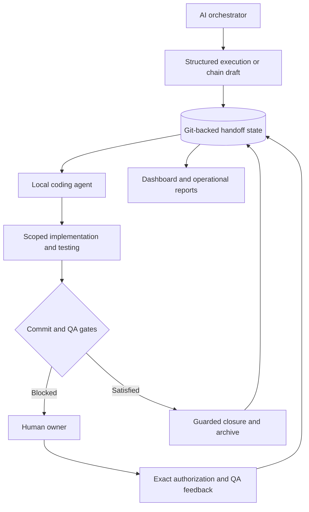

# Agent Handoff Protocol (AHP)

**Engineering case study · AI agent orchestration · Human-in-the-loop · Python · Git-backed state**

AHP is an independent software engineering project that coordinates AI-assisted development across conversational orchestrators and local coding agents. It moves execution state, authorization and validation evidence out of transient conversations into a structured, versioned workflow.

## Evidence at a glance

| Repository inventory | Observed count |
| --- | ---: |
| Archived execution files | **548** |
| Chain manifest files | **44** |
| Python package modules | **39** |
| Automated test modules | **49** |

Source: complete default-branch Git tree inspection, November 27, 2026. These counts are not a measure of unique successful executions or passing tests. A historical October 7 baseline separately records 247 execution records across 15 handoffs, including 231 completed records.

## The problem

Coding agents can lose context across sessions, modify unintended files, confuse a proposed action with an authorized one, or report success without adequate evidence. AHP addresses these problems through explicit execution contracts, canonical state, bounded permissions and guarded closure.

## How it works

- Python 3.11+ CLI with no declared runtime dependencies.
- Markdown execution artifacts, TOML manifests and JSON authorizations.
- Linear execution chains with digest-bound human approval.
- Scoped Git freshness, expected HEAD checks and file-level commit allowlists.
- Risk-adaptive QA levels, corrective updates and deterministic resume decisions.
- Local and SSH repository targeting, bounded automation and operational reporting.

## Applied engineering cases

| Project | Recorded outcome |
| --- | --- |
| Automated content factory | Isolated PostgreSQL restore with matching counts across 12 tables |
| Landing Express | Generation-library stage: 978 full-suite tests reported passing and browser QA PASS |
| Color Vault | Solver and procedural generator: 107 core and 15 widget tests reported passing |
| AHP reporting | 23 focused tests reported passing for read-only operational reporting |

These outcomes are recorded in historical handoffs and supplied audit evidence. They are not newly executed tests or comparative productivity measurements.

## Technical documentation

- [Architecture](docs/architecture.md)
- [Protocol design and lifecycle](docs/protocol-design.md)
- [Agent orchestration](docs/agent-orchestration.md)
- [Governance and safety](docs/governance-and-safety.md)
- [Engineering challenges](docs/engineering-challenges.md)
- [Real-world case studies](docs/real-world-case-studies.md)
- [Metrics and evidence](docs/metrics-and-evidence.md)
- [Lessons learned and future direction](docs/lessons-learned.md)

## Scope and transparency

The inspected protocol is an alpha-stage CLI, primarily operated by its owner, with ChatGPT and OpenCode as the documented operational pairing. The runtime contract addresses additional agents, but equivalent compatibility is not established. Chain v1 is sequential, not a parallel DAG engine.

The case study does not claim complete autonomy, guaranteed security, enterprise adoption, measured cost savings or faster delivery. Synchronization, continuity and cross-agent compatibility remain areas for improvement. Possible v2 directions are clearly separated from implemented behavior.

This repository contains sanitized documentation only. Original source, raw handoff data, employer-specific information, private paths and credentials are excluded. Based on source inspection and selected execution records as of November 27, 2026.
