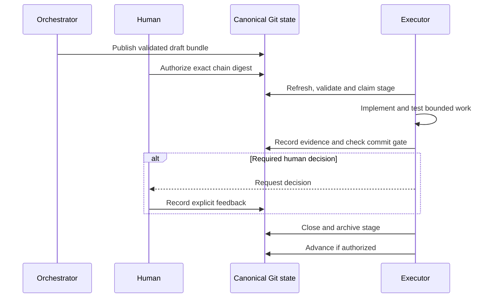

# Agent orchestration

The documented operating model uses ChatGPT as external orchestrator, a human as the authority owner, and OpenCode as local execution agent. The runtime contract also addresses other execution clients, including Codex; equivalent practical compatibility has not been established.

| Actor | Responsibility |
| --- | --- |
| Orchestrator | Prepare complete execution or chain drafts and publish scoped handoff artifacts |
| Human | Approve exact chain digests, QA verdicts and additional side effects |
| Executor | Validate freshness, claim, implement, test, record evidence and close through native commands |

## Execution loop

The CLI exposes bounded automatic next/resume/chain operations and optional dispatch, workstation bridge, review gateway and remote ingress. These are controlled mechanisms over canonical state, not a claim of unattended end-to-end reliability.

The orchestrator does not commit product code or generate its own human authorization. Remote work uses a repository-target abstraction rather than treating SSH destinations as local paths.
