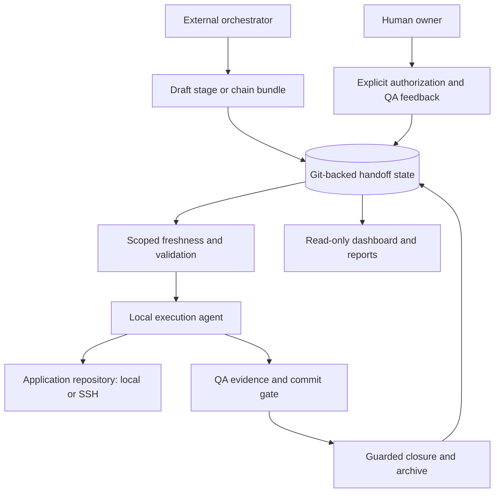

# Architecture

AHP (Agent Handoff Protocol) is a Python 3.11+ command-line tool and a Git-backed coordination protocol. The inspected package declares no runtime dependencies and is classified as alpha. Its purpose is to separate planning, execution, authorization and evidence from conversational context.

| Layer | Responsibilities |
| --- | --- |
| Protocol package | CLI, parsers, validators, templates, lifecycle |
| Handoff repository | Manifests, active execution, chain bundles, archived evidence |
| Application repositories | Product source, tests and technical documentation |
| Repository target abstraction | Local and SSH-backed Git operations |
| Transport | Scoped Git freshness and publication, conflict handling |
| Optional automation | Bounded dispatch, bridge, review gateway and ingress |
| Observability | Local dashboard, daily and weekly reports |

The repositories are intentionally separate. AHP is not a hosted inference service, distributed task queue or autonomous agent model. It coordinates agents that already have an execution environment. Scope-isolated workspaces are an opt-in pilot, not evidence of universal deployment.

The inspected implementation tree contains 39 Python package modules and 49 test modules. These are file counts, not test execution results.
