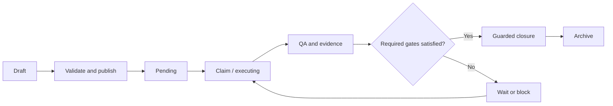

# Protocol design

## Canonical artifacts

AHP uses human-readable Markdown for execution instructions and evidence, TOML for structured manifests and ordered chains, JSON for authorization artifacts, and Git for canonical transport.

An execution specifies the target repository and branch, expected starting revision, objective, bounded scope, validation requirements, acceptance criteria and applicable commit permissions. The active execution is distinct from the project summary, roadmap and historical archive.

The runtime contract gives precedence to terminal archives, active execution state, queued drafts and project summaries, ahead of conversational output.

## Lifecycle

This is a conceptual workflow, not an exhaustive state enum. Corrective updates can remain within the active execution when the objective, file allowlist, authority and QA level do not change.

## Chains

A chain defines an ordered linear sequence of stages. The implementation validates the complete bundle and computes a digest over the authorized definition. A human authorizes that exact bundle. Native advancement checks canonical state and stop conditions. The original baseline is not silently rewritten when target HEAD changes; explicit acceptance can record the new revision.

Chain v1 does not implement a DAG, parallel stage execution or blanket push/deploy authorization. A branch existing is not permission.
